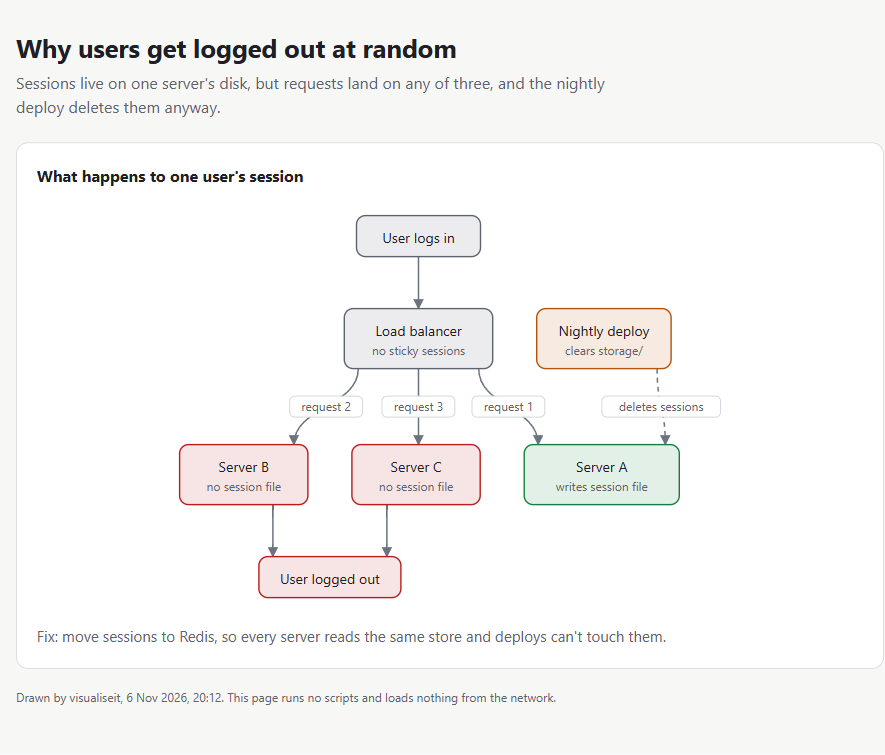
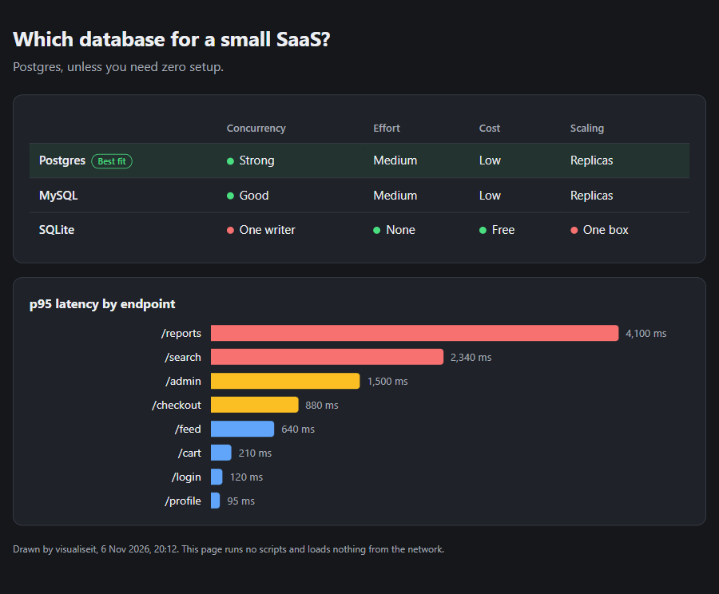

# claude-visualiseit

**Diagrams instead of walls of text in Claude Code.** Type `/visualiseit` and Claude redraws its last reply as a picture. Turn on auto mode and it draws one by itself when a reply is complex enough to need it, and you choose how often with `low`, `medium` or `high`.

**Before**

```text
Each server keeps its own session files on its own disk, and the load balancer has no sticky
sessions, so when a user logs in on Server A the session file is written there, then their next
request can land on Server B or C, which have no such file, so Laravel treats them as logged out.
Separately, the nightly deploy clears the storage folder, which deletes the files on Server A too...
```

**After**, right in the terminal:

```text
                       ┌──────────────┐
                       │ User logs in │
                       └───────┬──────┘
                               ▼
                    ┌────────────────────┐  ┌──────────────────┐
                    │   Load balancer    │  │ ! Nightly deploy │
                    │ no sticky sessions │  │ clears storage/  │
                    └─┬────────┬────────┬┘  └─────────────────┬┘
            request 2 │        │        │ request 1           ┆
                 ┌────┘        │        └───┐                 └┐
                 │             │ request 3  │ deletes sessions ┆
                 ▼             ▼            ▼                  ▼
┌─────────────────┐  ┌─────────────────┐  ┌─────────────────────┐
│   ✗ Server B    │  │   ✗ Server C    │  │     ✓ Server A      │
│ no session file │  │ no session file │  │ writes session file │
└───────────┬─────┘  └───────┬─────────┘  └─────────────────────┘
            ▼                ▼
          ┌───────────────────┐
          │ ✗ User logged out │
          └───────────────────┘
```

**Or as a page**, when it's too big for the terminal or you ask for one. Pages follow your light or dark theme:





## Install: paste this into Claude Code

```text
Install the claude-visualiseit plugin for me from https://github.com/NathnC/claude-visualiseit.
1. Run: claude plugin marketplace add NathnC/claude-visualiseit
2. Run: claude plugin install visualiseit@claude-visualiseit
3. Check Node.js is on my PATH (node --version). The plugin needs it; tell me if it's missing.
4. Tell me to restart Claude Code, then summarise in two lines how to use /visualiseit and /visualiseit low, medium or high.
```

Or type this slash command at the Claude Code prompt. It needs Claude Code 2.1.275 or later, and asks you to confirm adding the marketplace:

```text
/plugin install visualiseit --marketplace NathnC/claude-visualiseit
```

On an older version, use two commands:

```text
/plugin marketplace add NathnC/claude-visualiseit
/plugin install visualiseit@claude-visualiseit
```

Or install from a terminal:

```bash
claude plugin marketplace add NathnC/claude-visualiseit
claude plugin install visualiseit@claude-visualiseit
# then restart Claude Code
```

To check it worked, type `ping`, then `/visualiseit`. You should get this:

```text
Ping got a pong

The exchange
 You   Claude
  │       │
  │  ping │
  ├───────►
  │  pong │
  ◄┄┄┄┄┄┄┄┤
  │       │
```

The exact wording will vary, because Claude writes the labels.

## Use

| Command | What it does |
|---|---|
| `/visualiseit` | Redraws Claude's previous reply as a diagram. |
| `/visualiseit the deploy part` | Draws only that part, or a topic you name. |
| `/visualiseit page` | Forces a page in your browser. |
| `/visualiseit terminal` | Forces a diagram in the terminal. |
| `/visualiseit on` | Turns on auto mode at your saved level. It stays on for future sessions. |
| `/visualiseit off` | Turns off auto mode and keeps your level. `/visualiseit` still works. |
| `/visualiseit low` | Auto mode draws rarely, only when a reply would be hard to follow without a picture. |
| `/visualiseit medium` | Auto mode draws for clearly structured replies. This is the default. `med` works too. |
| `/visualiseit high` | Auto mode draws whenever a reply has any real structure. |
| `/visualiseit status` | Shows the current settings. |

Setting a level also turns auto mode on.

You can also just ask, for example: "draw me that" or "explain that visually".

A redraw shows only what the reply said. Claude is told not to add facts, steps or numbers, and to keep a label vague where the reply was vague.

## When auto mode draws

Auto mode is off until you run `/visualiseit on` or set a level. Then, before a final reply, Claude checks whether the reply's main point is one of these structures. The level sets how much it takes:

| Structure | `low` | `medium` | `high` |
|---|---|---|---|
| Process or flow | 2+ branches, or 8+ steps | Branches, or 5+ steps | A branch, or 3+ steps |
| Components and how they connect | 5+ | 3+ | 2+ |
| Options compared | 4+ on 3+ criteria | 3+ on 2+ criteria | 2+ |
| Numbers compared or ranked | 8+ | 5+ | 3+ |
| Before/after | Of a whole system | Of a system | Of anything |
| Dated or dependent items | 6+ | 4+ | 3+ |
| Root cause | Through 4+ parts | Through 3+ parts | Any cause and effect chain |
| If in doubt | Don't draw | Don't draw | Draw |

At every level it stays out of short answers, single facts, yes/no, code and diffs, commands, plain lists, confirmations, routine status and questions to you.

**The first time it fires, Claude Code asks to allow the skill.** Choose "don't ask again". `/visualiseit` itself never asks. To skip the prompt altogether, add this to your `~/.claude/settings.json`:

```json
{ "permissions": { "allow": ["Skill(visualiseit:visualiseit)"] } }
```

When it does draw, the visual replaces the explanation: Claude keeps the words around it to about 60, plus any exact commands you need.

Tested with real Claude runs on Sonnet, against the same [34 prompts](evals/cases.json) at each level:

| Level | Drew on | Right calls | Median words beside the diagram |
|---|---|---|---|
| `low` | 9 of 34 | 26/27 | 43 |
| `medium` | 13 of 34 | 34/34 | 51 |
| `high` | 18 of 34 | 31/31 | 44 |

"Right calls" leaves out prompts that could fairly go either way at that level, which is why the totals differ. The one miss was on `low`, which drew for a three-part setup it should have left alone. An earlier run on Opus at `medium` got 28/28 on the original 28 prompts.

That's one run per prompt, on prompts written while tuning the rules, so treat it as a sign the levels work rather than a measured accuracy. These prompts were picked to test the rules, so don't read 13 of 34 as how often it'll draw in your sessions. Run `node evals/run.mjs --level high` to check it yourself.

## Examples

Every diagram below is real output from the script. The spec above each one is what Claude writes, and the script does the rest.

### `sequence`: who calls whom, in order

```text
title: How a login gets a token

sequence: One login, in order
actors: Browser | API | Database
Browser -> API | POST /login
API -> Database | find user
Database --> API | user row
API --> Browser | token
```

```text
How a login gets a token

One login, in order
 Browser          API       Database
    │              │            │
    │  POST /login │            │
    ├──────────────►            │
    │              │  find user │
    │              ├────────────►
    │              │  user row  │
    │              ◄┄┄┄┄┄┄┄┄┄┄┄┄┤
    │  token       │            │
    ◄┄┄┄┄┄┄┄┄┄┄┄┄┄┄┤            │
    │              │            │
```

### `flow`: branches and loops

```text
title: A failed payment retries twice, then a person gets it

flow: Payment handling
Charge card -> Paid?
Paid? -> Send receipt | yes
Paid? -> Retry queue | no
Retry queue --> Charge card | up to 2 retries
Retry queue -> Alert support | still failing
node: Send receipt | Send receipt | tone=good
node: Alert support | Alert support | tone=bad
```

```text
A failed payment retries twice, then a person gets it

Payment handling
               ┌─────────────┐
               │ Charge card │
               └─┬───────────┘
                 │          ▲ up to 2 retries
                 │         ┌┘
                 │         ┆
                 ▼         ┆
              ┌───────┐    ┆
              │ Paid? │    ┆
              └─┬────┬┘    ┆
            yes │    │ no  ┆
                │    └┐    └┄┄┄┄┄┐
                │     │          ┆
                ▼     ▼          ┆
┌────────────────┐  ┌────────────┴┐
│ ✓ Send receipt │  │ Retry queue │
└────────────────┘  └──────┬──────┘
                           │ still failing
                           ▼
                  ┌─────────────────┐
                  │ ✗ Alert support │
                  └─────────────────┘
```

### `compare`: options against criteria

```text
title: Postgres fits a small multi-tenant SaaS best

compare: Database options
columns: Concurrency | Row-level security | Hosting cost
best: Postgres | High ~good | Built in ~good | Medium
row: MySQL | High ~good | None ~bad | Medium
row: SQLite | One writer ~bad | None ~bad | Free ~good
```

```text
Postgres fits a small multi-tenant SaaS best

Database options
┌────────────┬──────────────┬────────────────────┬──────────────┐
│            │ Concurrency  │ Row-level security │ Hosting cost │
├────────────┼──────────────┼────────────────────┼──────────────┤
│ ★ Postgres │ ✓ High       │ ✓ Built in         │ Medium       │
├────────────┼──────────────┼────────────────────┼──────────────┤
│ MySQL      │ ✓ High       │ ✗ None             │ Medium       │
├────────────┼──────────────┼────────────────────┼──────────────┤
│ SQLite     │ ✗ One writer │ ✗ None             │ ✓ Free       │
└────────────┴──────────────┴────────────────────┴──────────────┘
```

### `bars`: quantities side by side

```text
title: Most of the page load is one query

bars: Time per request
unit: ms
bar: Orders query | 840 | tone=bad
bar: Template render | 120
bar: Auth check | 45
bar: Cache lookup | 8 | tone=good
```

```text
Most of the page load is one query

Time per request
✗ Orders query  ███████████████████████████████████████████████████████ 840 ms
Template render ███████▉ 120 ms
Auth check      ███ 45 ms
✓ Cache lookup  ▌ 8 ms
```

### `timeline`: dated or ordered events

```text
title: The outage took 47 minutes from deploy to fix

timeline: Tuesday
at: 14:02 | Deploy goes out
at: 14:09 | Error rate climbs | detail=checkout only | tone=warn
at: 14:21 | Alert fires | tone=bad
at: 14:35 | Rollback starts
at: 14:49 | Back to normal | tone=good
```

```text
The outage took 47 minutes from deploy to fix

Tuesday
14:02 ● Deploy goes out
      │
14:09 ● ! Error rate climbs
      │   checkout only
      │
14:21 ● ✗ Alert fires
      │
14:35 ● Rollback starts
      │
14:49 ● ✓ Back to normal
```

### `tree`: hierarchies and file structures

```text
title: Where the auth code lives

tree: Project layout
- my-app
  - app
    - Http
      - Controllers | detail=login routes
      - Middleware | detail=token check | tone=warn
    - Models
  - config
    - auth.php | detail=guards
  - tests
```

```text
Where the auth code lives

Project layout
my-app
├─ app
│  ├─ Http
│  │  ├─ Controllers (login routes)
│  │  └─ ! Middleware (token check)
│  └─ Models
├─ config
│  └─ auth.php (guards)
└─ tests
```

### Things to type

```text
/visualiseit                         redraw the last reply
/visualiseit the rollback step       draw only that part
/visualiseit page                    open the last reply as a page
/visualiseit terminal the database   draw that part in the terminal
/visualiseit high                    draw more often from now on
/visualiseit low                     draw less often from now on
draw me how those services connect   works without the slash command
```

## What it can draw

| Shape | For |
|---|---|
| `flow` | Parts and how they connect, branching logic, dependencies, cause and effect |
| `sequence` | Who calls whom, in order |
| `compare` | Options against criteria |
| `bars` | Quantities side by side |
| `timeline` | Dated or ordered events |
| `tree` | Hierarchies and file structures |
| `html` | Anything else, as custom SVG or HTML. Pages only |

Claude doesn't draw these by hand. It writes a few lines of plain text and a script does the layout, so boxes line up, labels don't collide and bars are to scale. That also uses far fewer tokens than having Claude write out a whole SVG:

```text
title: Why users get logged out at random

flow: What happens to one user's session
User logs in -> Load balancer
Load balancer -> Server A | request 1
Load balancer -> Server B | request 2
Server B -> User logged out
Nightly deploy --> Server A | deletes sessions
```

The script picks the output. A small diagram goes in the terminal. Anything wider than `width`, taller than 60 lines, with more than two sections or with lots of crossing lines becomes a page. Set `surface` or use `page` and `terminal` to choose for yourself.

## Safety

Diagrams often describe code, logs and web pages you didn't write, so a page is treated as untrusted content.

- **Pages can't run anything or call out.** Each one is a single file with a Content-Security-Policy of `default-src 'none'`, and it has no scripts and loads nothing from the network. Custom HTML also has scripts, event handlers, frames, forms, remote links and redirects removed before it's written.
- **Things that look like secrets are masked.** API keys, tokens, JWTs, private keys, passwords and credentials in URLs become `[masked]` in both outputs, and Claude tells you when that happens. This is pattern matching, so it can miss one. Claude is also told to leave secrets out.
- **Terminal output is cleaned.** Escape sequences and bidirectional text overrides are stripped from labels, so a label can't rewrite your terminal or disguise what it says.
- **Pages stay on your machine.** They're saved to `~/.claude/visualiseit/pages/`, only your user can read them on macOS and Linux, and they're deleted after 14 days. Nothing is uploaded by the plugin.
- **The script has no dependencies**, so there's nothing to install from npm. It never makes a network request.
- **The skill can only run its own script.** Its permission is pinned to that one path, so it doesn't open up `node` in general. `node -e` still needs your approval while the skill is running.

The test suite includes 29 attempts to get active content past the sanitiser. Hostile pages were also loaded in a real browser, with and without the sanitiser, against a local server logging every request: no script ran and no request arrived.

## Config (optional)

Settings go in `~/.claude/visualiseit/config.json`:

```json
{
  "auto": false,
  "level": "medium",
  "surface": "auto",
  "open": true,
  "keepDays": 14,
  "width": 78
}
```

- `auto` is what `/visualiseit on` and `off` change.
- `level` is how often auto mode draws: `low`, `medium` or `high`. `/visualiseit low`, `medium` and `high` change it.
- `surface` can be `auto`, `terminal` or `page`.
- `open: false` writes pages without opening a browser. It's also skipped over SSH or with no display, and you get the path instead.
- `keepDays` is how long pages are kept. They're cleaned up whenever a new page is written.
- `width` is the widest a terminal diagram can be, from 40 to 240 characters.

## Limits

- **Auto mode is Claude's judgement, not a guarantee.** It's instructions rather than a hard rule, so it can occasionally miss a reply that deserved a picture, or draw one you didn't need. The levels change how readily it draws, not exact counts. `/visualiseit` covers the misses.
- **Token cost:** auto mode adds about 230 tokens at session start and about 25 per prompt. Each diagram then costs its JSON plus, for the terminal, the pasted diagram. With auto mode off, the only cost is the skill's one-line listing.
- **Terminal diagrams need a monospace font with box-drawing characters,** and a window at least as wide as `width`. Emoji and CJK widths vary by terminal, so those labels can shift by a character in some.
- **Pages open a browser tab,** including when auto mode draws one you didn't ask for. Set `open` to `false` if you'd rather click the path.
- **`claude -p` and the SDK:** auto mode is off in scripted runs, so it won't draw into piped output. `/visualiseit` still works if you ask for it.
- **[`claude-incognito`](https://github.com/NathnC/claude-incognito):** incognito sessions never write a page, because a page would outlive the session that's being deleted. Diagrams stay in the terminal.
- **Changing mid-session:** Claude is told to stop or to use the new level, but the check it read earlier stays in its context until the session compacts or ends. A new session is the clean way to apply a change.
- Needs Node.js on `PATH`. Claude Code installed through npm already has it.

## Develop

```bash
node --test                         # unit tests, no tokens used
claude --plugin-dir .               # run it from this folder
claude plugin validate .            # check the manifest and hooks
node evals/run.mjs --level medium   # measure auto mode at a level. Uses real tokens, about $1.50 on Sonnet
```

## Uninstall

```bash
claude plugin uninstall visualiseit@claude-visualiseit
claude plugin marketplace remove claude-visualiseit
```

Then delete `~/.claude/visualiseit/`, which holds your settings and saved pages.

## License

MIT
